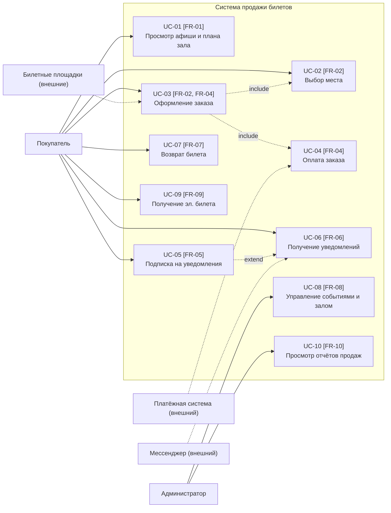

# Лабораторная работа №1. Формулирование требований к программной системе

| Поле | Значение |
|---|---|
| **Студент** | Бренёв Юрий Сергеевич |
| **Группа** | РИС-23-2 |
| **Вариант** | №5 — Сайт продажи билетов на концерты |

**Тема:** Анализ предметной области и формулирование требований к программной системе.

**Цель работы:** Научиться анализировать поставленную задачу, выделять заинтересованных лиц, формулировать функциональные и нефункциональные требования, представлять результаты в виде диаграммы вариантов использования.

---

## Краткое описание системы

Проектируется система онлайн-продажи билетов на концерты и другие крупные выступления. Её главная особенность — работа в условиях пиковой нагрузки: в момент старта продаж одновременно действуют тысячи пользователей с всплеском до 10 000 запросов в секунду. Покупатели просматривают план зала, выбирают и оплачивают места онлайн, подписываются на уведомления о старте продаж и могут вернуть билет до начала выступления. Система интегрируется с платёжными сервисами, внешними билетными площадками и мессенджером для оповещений, а критическое бизнес-требование — гарантировать, что одно место не будет продано дважды.

---

## Оглавление

1. [Стейкхолдеры](#1-перечень-заинтересованных-лиц-стейкхолдеров)
2. [Функциональные требования](#2-перечень-функциональных-требований)
3. [Диаграмма вариантов использования](#3-диаграмма-вариантов-использования)
4. [Нефункциональные требования](#4-перечень-нефункциональных-требований)
5. [Предположения](#5-перечень-сделанных-предположений-повышенная-сложность)
6. [Чек-лист самопроверки](#6-чек-лист-самопроверки)

---

## 1. Перечень заинтересованных лиц (стейкхолдеров)

Выделено 6 стейкхолдеров, из них три внешних (платёжная система, билетные площадки, мессенджер).

| ID | Стейкхолдер | Роль | Интересы / цели | Влияние |
|----|-------------|------|-----------------|---------|
| SH-01 | Покупатель | Конечный пользователь | Быстро купить билет на нужное место; получать уведомления о старте продаж | высокое |
| SH-02 | Организатор (компания) | Владелец системы | Максимизировать продажи; видеть отчётность в реальном времени | высокое |
| SH-03 | Платёжная система | Внешний сервис | Безопасно обрабатывать оплату, исключать мошенничество | среднее |
| SH-04 | Внешние билетные площадки | Внешний партнёр | Синхронизировать каталог и продажи на своих площадках | среднее |
| SH-05 | Мессенджер | Внешний партнёр | Доставлять push-уведомления пользователям | низкое |
| SH-06 | Служба поддержки | Внутренний персонал | Обрабатывать возвраты и спорные ситуации | низкое |

Покупатель и организатор имеют высокое влияние: первый пользуется системой ежедневно и определяет выручку, второй принимает решения о функциональности и правилах продаж. Внешние сервисы влияют на надёжность оплаты, охват аудитории и доставку уведомлений.

---

## 2. Перечень функциональных требований

Выделено 11 функциональных требований, покрывающих всех ключевых стейкхолдеров. Приоритизация по MoSCoW: Must — без чего продукт не работает (продажа, оплата, защита от двойной продажи), Should — важные функции для ценности продукта, Could — желательные, если останутся ресурсы.

| ID | Требование | Стейкхолдер | Приоритет (MoSCoW) | Обоснование |
|----|------------|-------------|---------------------|-------------|
| FR-01 | Система должна показывать афишу событий и актуальный план зала со свободными местами | SH-01 | Must | Без просмотра мест покупатель не может совершить покупку |
| FR-02 | Покупатель может выбрать конкретное место и добавить билет в корзину | SH-01 | Must | Базовая операция покупки |
| FR-03 | Система должна исключать двойную продажу одного места при одновременных покупках | SH-02 | Must | Ключевое бизнес-правило; двойная продажа делает систему неработоспособной |
| FR-04 | Покупатель может оплатить заказ онлайн через платёжную систему (карта, СБП) | SH-01, SH-03 | Must | Оплата завершает сделку и фиксирует бронь |
| FR-05 | Покупатель может оформить подписку с преференциями и приоритетом оповещения | SH-01 | Should | Удерживает клиентов, но не блокирует основную покупку |
| FR-06 | Система должна уведомлять подписчиков о старте продаж и изменениях через мессенджер | SH-01, SH-05 | Should | Улучшает охват и продажи в пиковые моменты |
| FR-07 | Покупатель может вернуть билет до начала выступления | SH-01 | Should | Требование политики работы с клиентами |
| FR-08 | Администратор может создавать события и настраивать схему зала и цены | SH-02 | Must | Без управления каталогом система не функционирует |
| FR-09 | Система должна формировать и отправлять покупателю электронный билет с QR-кодом | SH-01 | Must | Билет — подтверждение покупки и пропуск на мероприятие |
| FR-10 | Администратор может просматривать отчёт по продажам в реальном времени | SH-02 | Should | Нужен для контроля выручки, но не критичен для продажи |
| FR-11 | Система должна синхронизировать каталог и продажи с внешними билетными площадками | SH-02, SH-04 | Could | Расширяет охват, но не обязательна для базового запуска |

---

## 3. Диаграмма вариантов использования

Диаграмма выполнена в Mermaid. Акторы соответствуют п.1 (внешние сервисы показаны как вторичные акторы). Каждый Use Case привязан к функциональному требованию из п.2: ID требования указан в названии Use Case.

**Связь с требованиями:** ID соответствующего FR указан в названии Use Case (например, `UC-03 [FR-02, FR-04]`).

### Диаграмма

### Описание ключевого сценария

| Поле | Значение |
|---|---|
| **Use Case** | UC-03 [FR-02, FR-04] Оформление заказа |
| **Актор** | Покупатель |
| **Предусловие** | Билеты на событие в продаже; выбранное место свободно; покупатель авторизован |
| **Основной поток** | 1. Покупатель выбирает событие и место → 2. Система проверяет, что место не занято → 3. Покупатель подтверждает заказ → 4. Система формирует заказ и передаёт его на оплату → 5. Платёжная система подтверждает оплату → 6. Система бронирует место и генерирует электронный билет с QR-кодом → 7. Покупатель получает билет |
| **Постусловие** | Место забронировано за покупателем; билет выдан; повторная продажа места невозможна |
| **Альтернативный поток** | 3a. Место занято другим покупателем → система предлагает выбрать другое место. 5a. Оплата отклонена → бронь не фиксируется, покупатель возвращается к выбору |

---

## 4. Перечень нефункциональных требований

Выбраны 5 наиболее значимых NFR. Они напрямую вытекают из постановки: пиковая нагрузка до 10 000 запросов/сек, запрет двойной продажи места и работа с платёжными данными. Требования вроде портируемости или совместимости со старыми браузерами отброшены как некритичные.

| ID | Категория | Требование | Метрика / критерий приёмки | Почему выбрано |
|----|-----------|------------|----------------------------|----------------|
| NFR-01 | Performance | Время отклика API в пиковые моменты | ≤ 500 мс (p95) при 10 000 RPS | Всплеск до 10 000 запросов/сек в момент старта продаж — ключевое условие постановки |
| NFR-02 | Consistency | Место не может быть продано более одного раза | 0 случаев двойной продажи | Явное бизнес-требование «не продавать место больше одного раза» |
| NFR-03 | Availability | Доступность системы в момент старта продаж | ≥ 99,95 % в часы продаж | Недоступность в пик напрямую означает потерю выручки |
| NFR-04 | Scalability | Горизонтальное масштабирование под пиковую нагрузку | рост до 10× без деградации времени отклика > 20 % | Нагрузка имеет резкие всплески; система должна эластично расширяться |
| NFR-05 | Security | Защита платёжных данных и операций | PCI DSS; TLS 1.3; OWASP Top 10 = 0 High | Система обрабатывает оплату — компрометация данных недопустима |

---

## 5. Перечень сделанных предположений (повышенная сложность)

Постановка не уточняет ряд параметров, влияющих на архитектуру и объём работ. Ниже — принятые допущения.

| ID | Предположение | Влияние на требования |
|----|---------------|-----------------------|
| A-01 | Система работает в РФ, интерфейс на русском языке | Локализация интерфейса; соответствие 152-ФЗ (хранение персональных данных) |
| A-02 | Платёжные данные карт не хранятся — оплата через внешних платёжных провайдеров | Сужается scope PCI DSS (NFR-05) |
| A-03 | Часовой пояс — МСК (UTC+3) | Единый таймстамп старта продаж и возвратов |
| A-04 | Билеты только электронные (QR-код), физической доставки нет | Отсутствует логистика доставки; упрощается FR-09 |
| A-05 | Пик нагрузки — первые минуты старта продаж | Проектирование под burst-нагрузку (NFR-01, NFR-04) |
| A-06 | Возврат билета возможен только до начала выступления | Ограничивает срок действия FR-07 |

---
